
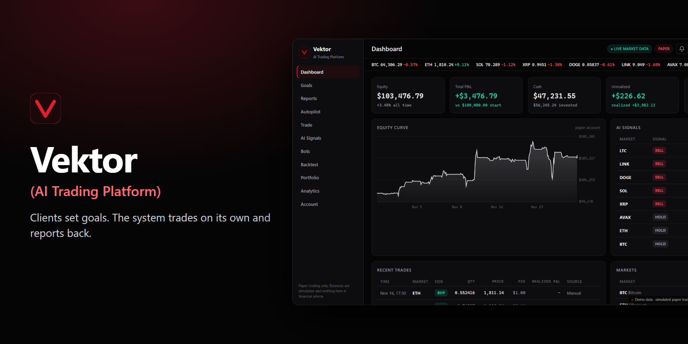

# Vektor (AI Trading Platform)

**Clients set goals. The system trades on its own and reports back.** A client signs in, picks a risk style, sets trading goals and presses one button. From then on Vektor scans the markets, trades only the strategies that pass its checks, protects the account with hard loss limits, and writes a plain-language report every day and every week.

> **This is a product showcase.** The Vektor software and its source code are proprietary and are **not** included in this repository. See [License](#license).

> **Paper trading.** Everything shown runs on a simulated account with live market prices. No trading system can guarantee profit, and nothing here is financial advice.

**Showcase website:** https://rana537omar.github.io/vektor-showcase/

## Demo video

<a href="https://rana537omar.github.io/vektor-showcase/#demo">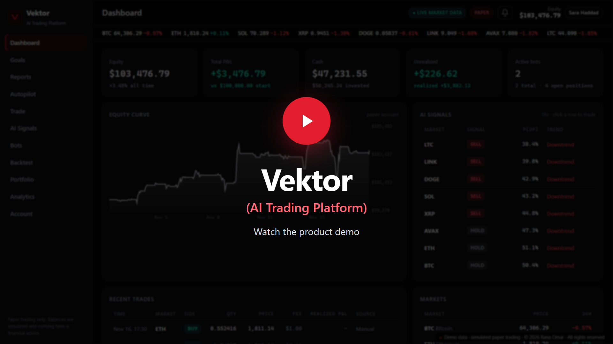</a>

A captioned walkthrough of 3 minutes 28 seconds, in 1080p. A new client creates an account, chooses a risk style, starts hands-off trading and sets four goals. The video then jumps two weeks ahead to show the account, goal progress, the automatic reports, the Autopilot's decisions, the trading terminal, the AI scanner, the backtester and optimizer, bots, analytics and notifications. The account history in the video is fictional demo data on a simulated account. **[Watch it on the showcase website](https://rana537omar.github.io/vektor-showcase/#demo)**.

## Features

### Goals and hands-off trading
- **Three risk styles**: conservative, balanced or aggressive, each with its own position sizes and loss limits.
- **One button to start**: the system then trades on its own, even when the client is signed out.
- **Four kinds of goal**: grow the account to a value by a date, a monthly profit target, a loss limit and a win-rate target.
- **Loss limit as a hard floor**: if the account falls that far, all automated trading is switched off and positions are sold.
- **Lock in a reached goal**: optionally stop trading the moment a growth goal is hit.
- **No chasing**: the system never raises risk to catch up when a goal is behind.

### Automatic reports
- **Daily and weekly**, written without anyone asking.
- **Plain language first**: what happened to the account, what the system did and why, and where each goal stands.
- **The numbers underneath**: change, trades, realized profit and loss, win rate, best and worst trade, fees.
- **Print or save as PDF**, and generate one on demand at any time.

### AI Autopilot
- **Scans every market on every new candle** and backtests six strategies on each.
- **Trades only what passes**: a strategy must have been profitable in both the earlier and the most recent part of the test window.
- **Risk-sized positions** with an automatic stop loss on each.
- **Stays in cash** when nothing qualifies, and stops for the day at a daily loss limit.
- **Explains itself**: every decision is written to a log.

### AI signals
- **A model trained on your own machine** for each market and timeframe, with no outside AI service.
- **Probability, confidence and the factors behind each signal.**
- **Honest accuracy**: scored on recent history the model never saw.

### Trading terminal
- **Live prices and a live order book.**
- **Candlestick charts** with moving averages, Bollinger bands, RSI, MACD and markers for your own trades.
- **Market and limit orders** with stop loss, take profit and trailing stops.
- **Price alerts** and a notification center.

### Backtesting, bots and analytics
- **Backtester** with fees and slippage, compared against buy and hold.
- **Parameter optimizer** that tests combinations and flags the robust ones.
- **Strategy bots** that run alongside the Autopilot.
- **Performance analytics**: win rate, profit factor, expectancy, drawdown, daily results, breakdown by market and source, CSV export.

### Accounts
- **Private account per client**: balance, positions, bots, goals, reports and alerts are never shared.
- **Passwords stored hashed**, sessions in HttpOnly cookies, login attempts rate-limited.
- **Runs on one small server** with its own database, and works on phones as well as desktops.

## Screenshots

### Goals and reports

| | |
|---|---|
| 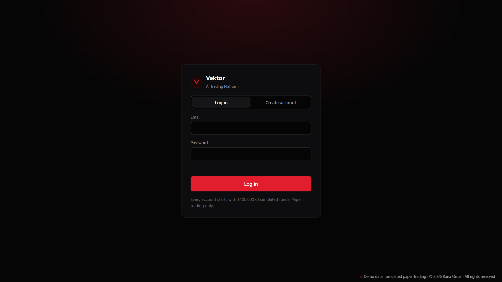 **Sign in**: every client has a private account. | 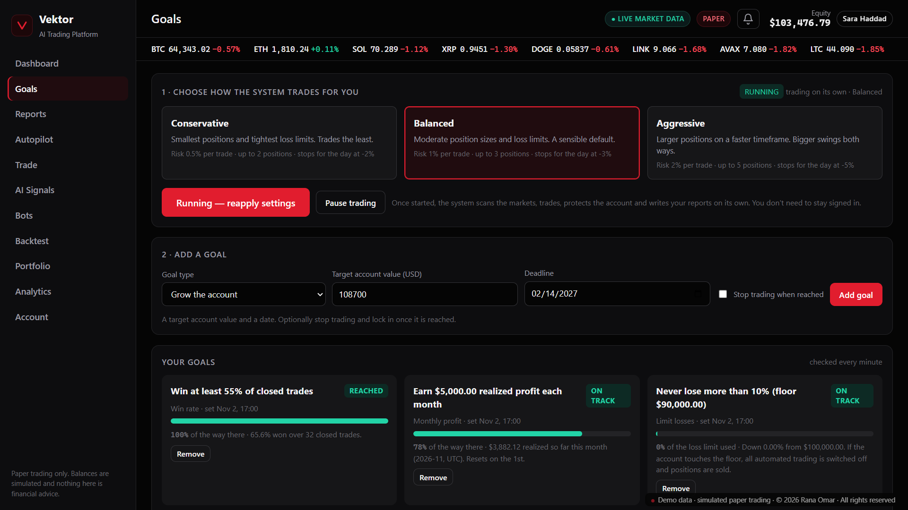 **Risk style**: choose one and start hands-off trading. |
| 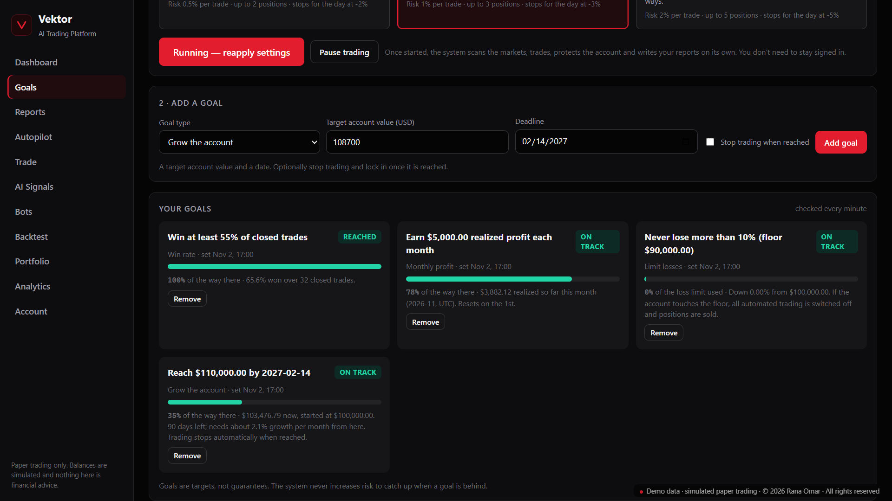 **Goals**: each one shows where it stands. | 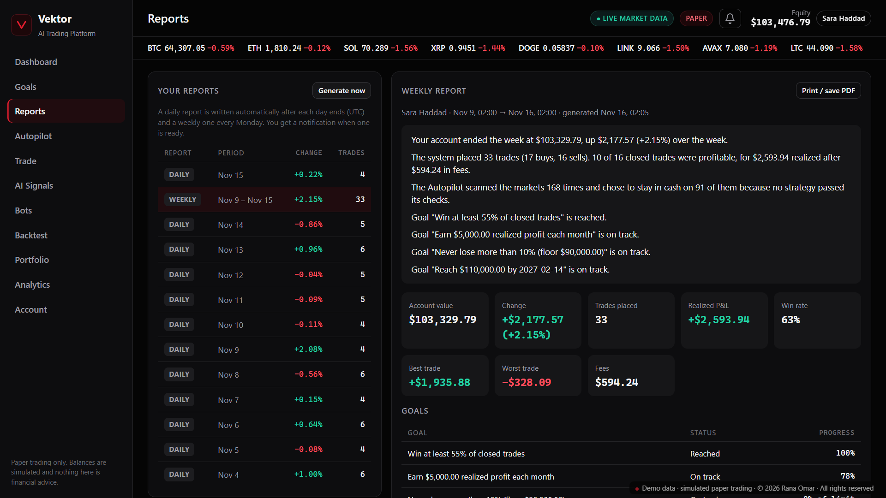 **Reports**: daily and weekly, written automatically. |

### The system at work

| | |
|---|---|
| 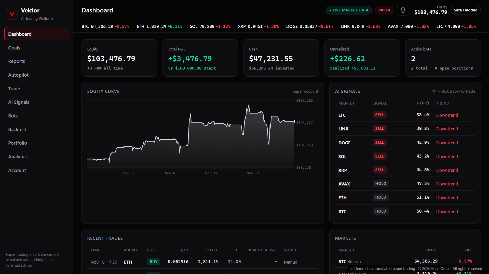 **Dashboard**: account value, equity curve, signals and trades. | 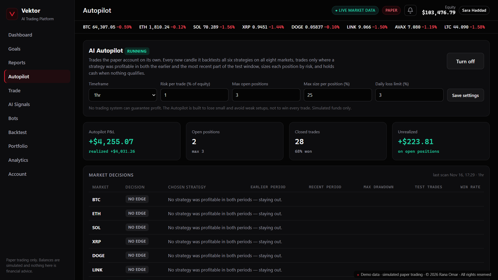 **Autopilot**: settings and results. |
| 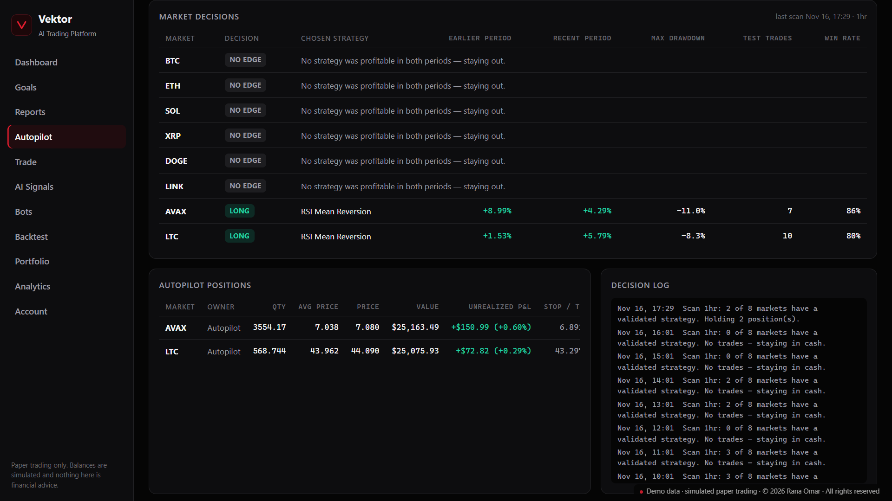 **Decisions**: what it chose for each market, and its log. | 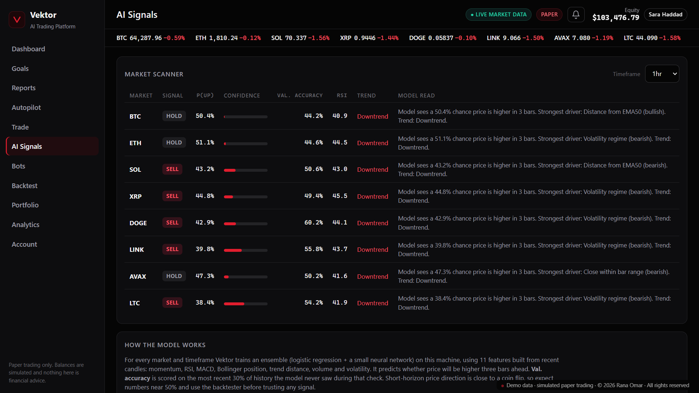 **AI signals**: a scanner across every market. |

### Trading and research

| | |
|---|---|
| 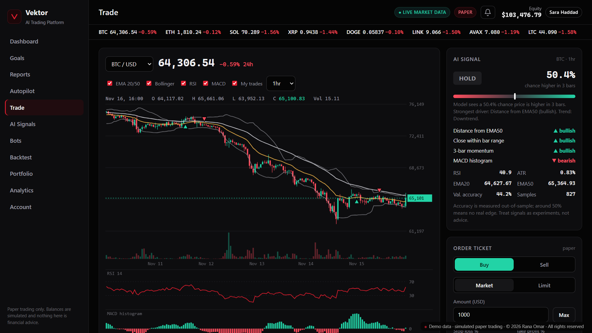 **Trade**: chart, indicators, AI signal and order ticket. | 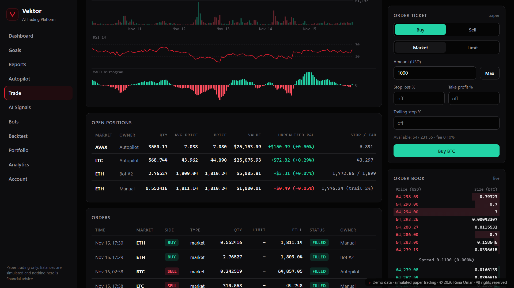 **Order book**: live depth, positions and orders. |
| 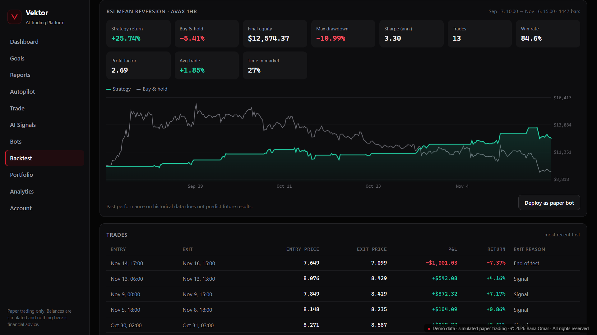 **Backtest**: a strategy against buy and hold. | 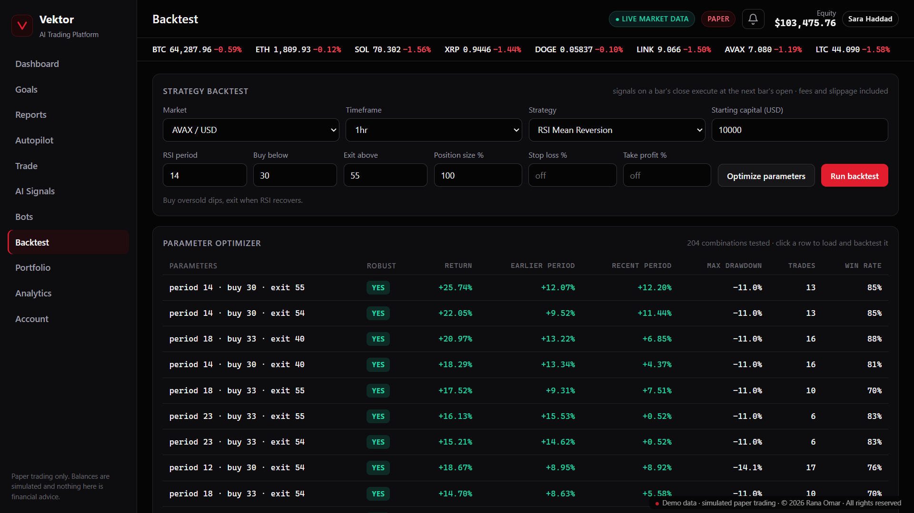 **Optimizer**: parameter combinations, robust ones flagged. |
| 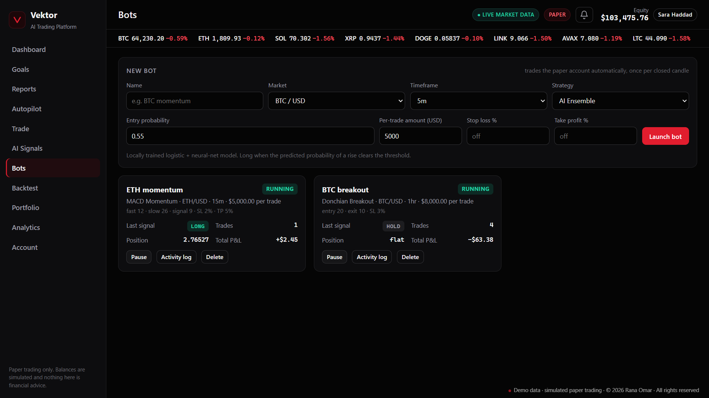 **Bots**: your own strategies on autopilot. | 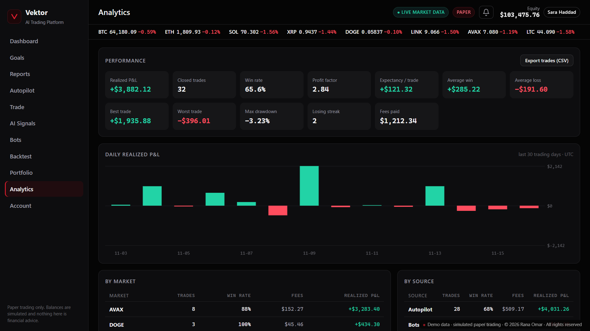 **Analytics**: performance in detail. |

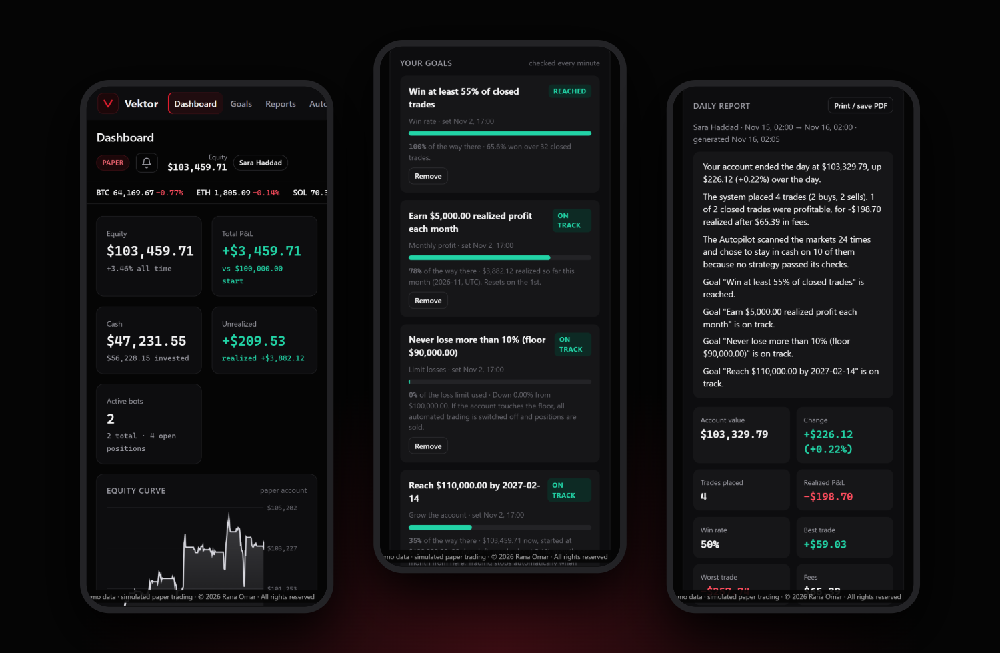

The account, client name, balances, trades, goals and reports in these screenshots and the video are fictional demo data on a simulated paper-trading account. Backtest figures come from historical prices. None of it is a real trading result or a promise of future performance.

## Get the full system

Want Vektor for your clients or your own trading desk, a live demo, or the complete source code? Message me on WhatsApp: **+20 120 856 2225**.

## License

**Copyright © 2026 Rana Omar. All rights reserved.** The text, screenshots, images and video in this repository are shared for viewing only. No license is granted to copy, reuse, modify, republish or use them, or the Vektor software they show, for any personal or commercial purpose. See [LICENSE](LICENSE).
